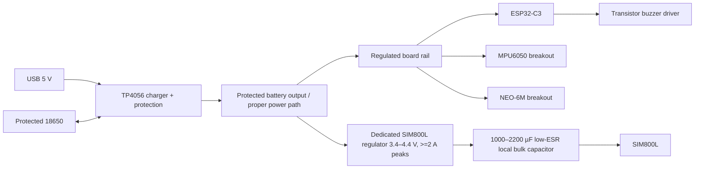

# CrashGuard Smart Helmet Firmware

This repository contains Arduino firmware for ESP32-C3 Super Mini and ESP32-WROOM-32 smart-helmet prototypes. It performs MPU6050 motion monitoring, a cancellable emergency countdown, bounded GPS acquisition, queued SIM800L SMS attempts, persistent settings, and a local authenticated captive portal.

It also includes a standalone NodeMCU ESP8266 version at `SmartHelmetESP8266/SmartHelmetESP8266.ino`. The NodeMCU target remains the default PlatformIO environment; select the environment matching the board you have.

## ESP32-WROOM-32 board version

The WROOM-32 target uses the common 30-pin ESP32 development-board pinout pictured by the user. It retains the same firmware, configuration, and captive portal as the ESP32-C3 version, with UART and I²C pins remapped for the classic ESP32. GPS uses UART2 on GPIO16/17 and GSM uses UART1 on GPIO26/27, leaving UART0 available for USB-to-serial logging.

| Component | Module pin | ESP32-WROOM-32 GPIO | Direction | Notes |
|---|---|---:|---|---|
| MPU6050 | SDA | 21 | Bidirectional | I²C; pull-ups must go to 3.3 V |
| MPU6050 | SCL | 22 | ESP → sensor | I²C clock |
| NEO-6M | TX | 16 | GPS → ESP | GPS UART RX at 9600 baud |
| NEO-6M | RX | 17 | ESP → GPS | GPS UART TX; normally unused |
| SIM800L | TXD | 26 | GSM → ESP | UART RX; check modem logic level |
| SIM800L | RXD | 27 | ESP → GSM | UART TX; level-shift if required by the modem |
| Buzzer driver | IN/gate/base | 25 | ESP → driver | Active-high transistor/MOSFET driver; never connect a high-current buzzer directly |
| Cancel button | Switch to GND | 33 | Input | Internal pull-up; hold for eight seconds during boot to reset the administrator password |
| Power | VIN / 3.3V / GND | Board pins | — | Use the correct regulated supply for the dev board and peripherals |

Build and upload with PlatformIO:

```powershell
platformio run -e esp32-wroom-32
platformio run -e esp32-wroom-32 -t upload
```

Open the Serial Monitor at 115200 baud. This target uses the development board's USB-to-UART bridge; do not enable the ESP32-C3 native USB CDC setting. GPIO16/17 are suitable for the classic ESP32-WROOM module shown, but may be unavailable on other ESP32 module variants such as WROVER boards. Confirm the board revision and wiring before connecting peripherals.

The ESP32 GPIOs are **not 5 V tolerant**. Verify that every sensor/UART signal presented to an ESP GPIO is at most 3.3 V. Power the SIM800L from a separate supply rated for its current bursts; do not power it from the ESP32 3.3 V pin. Connect all grounds together.

## Temporary NodeMCU ESP8266 version

The NodeMCU preserves the same portal, calibration, detection, countdown, GPS fallback, SMS queue, authentication, rate limiting, and event logging behavior. Configuration and the salted administrator password are stored in checksummed emulated EEPROM instead of ESP32 Preferences.

### NodeMCU signal wiring

| Component | Module pin | NodeMCU pin | GPIO | Direction | Notes |
|---|---|---:|---:|---|---|
| MPU6050 | SDA | D2 | 4 | Bidirectional | Pull up only to 3.3 V |
| MPU6050 | SCL | D1 | 5 | ESP → sensor | I²C clock |
| NEO-6M | TX | D5 | 14 | GPS → ESP | Software serial RX at 9600 baud |
| NEO-6M | RX | D6 | 12 | ESP → GPS | Software serial TX; normally unused |
| SIM800L | TXD | RX | 3 | GSM → ESP | Hardware UART RX; verify modem logic level |
| SIM800L | RXD | TX | 1 | ESP → GSM | Hardware UART TX; add divider if required |
| Buzzer driver | IN | D7 | 13 | ESP → driver | Active-high transistor/MOSFET driver |
| Cancel button | Switch to GND | D0 | 16 | Input | Internal pull-up; hold eight seconds during boot for password recovery |

Critical NodeMCU limitations:

- GPIO1/TX and GPIO3/RX are shared with the onboard USB-to-serial bridge. Disconnect both SIM800L UART wires while uploading firmware or using Serial Monitor. After flashing, power from the verified supply without an active USB data connection before reconnecting the modem UART.
- ESP8266 sends boot text on TX. Keep the SIM800L disabled or its RX isolated during reset so boot bytes cannot be interpreted as modem input. A production PCB should gate or multiplex this UART.
- Firmware intentionally produces no Serial debug logging on ESP8266 because that UART belongs to the modem. Use the authenticated portal event log.
- GPS uses software serial. Its 9600-baud stream is serviced continuously, but ESP8266 has fewer serial resources and less timing margin than ESP32-C3. Validate GPS sentence loss while Wi-Fi and GSM are active.
- D0/GPIO16 is suitable for the polled cancellation button used here, but it has different wake/interrupt capabilities from normal ESP8266 GPIOs.
- Do not use D3/GPIO0, D4/GPIO2, or D8/GPIO15 for external circuits that can violate their required boot levels.

Compile from this repository with:

```powershell
platformio run -e nodemcuv2
```

Or in Arduino IDE, install the **esp8266** platform using Boards Manager, then install **Adafruit MPU6050** and **TinyGPSPlus**. Open `SmartHelmetESP8266/SmartHelmetESP8266.ino` and select **NodeMCU 1.0 (ESP-12E Module)**. `SoftwareSerial.h` is supplied by the ESP8266 platform; it is not available when compiling this sketch for an ESP32 board. The verified Arduino CLI target is `esp8266:esp8266:nodemcuv2` using ESP8266 core 3.1.2.

The NodeMCU compilation completed successfully: global/static RAM 34,676 of 80,192 bytes (43%), IRAM 62,667 of 65,536 bytes (95%), and flash 320,760 of 1,048,576 bytes (30%). IRAM headroom is small, so recompile and inspect memory after adding libraries, interrupt handlers, networking features, or OTA support.

> Safety boundary: this is an experimental competition prototype, not automotive, medical, PPE, or life-safety certified equipment. Do not drill, cut, glue into, or otherwise modify a helmet shell or energy-absorbing liner. Use controlled bench simulations—not deliberate crashes or dangerous road tests.

## ESP32-C3 hardware assumptions and verification checklist

The name “ESP32-C3 Super Mini” covers multiple seller revisions. This project's C3 target provisionally uses the common board exposing GPIO0–10 and native USB. Before power-up:

- Match the silkscreen to the seller’s schematic and continuity-check every proposed pin.
- Confirm GPIO0, 1, 3, 4, 5, 6, 7, and 10 are exposed and not used by onboard hardware.
- Keep GPIO2, GPIO8, and GPIO9 free because ESP32-C3 treats them as strapping pins. Keep GPIO18/19 for native USB. GPIO12–17 are normally flash pins and are not used.
- Identify each breakout, not just its chip. Confirm whether its VCC input has a regulator and whether UART/I²C pins have level shifting.
- Confirm the MPU6050 and GPS output logic never exceeds 3.3 V at an ESP GPIO.
- Identify whether the SIM800L is a bare 3.4–4.4 V board or a “5 V” carrier with its own regulator. Never infer this from connector shape.
- Verify the cellular carrier still operates compatible 2G GSM in the deployment area.
- Use a protected quality 18650 cell, correctly fused wiring, and a power design rated for SIM800L current bursts. Do not prototype high-current battery paths on a solderless breadboard.

## ESP32-C3 provisional pin-to-pin wiring

### Signals

| Component | Module pin | ESP32-C3 connection | Direction | Logic | Notes |
|---|---|---:|---|---|---|
| MPU6050 | SDA | GPIO5 | Bidirectional | 3.3 V | I²C pull-ups must terminate at 3.3 V |
| MPU6050 | SCL | GPIO6 | ESP → sensor | 3.3 V | Common GND required |
| NEO-6M | TX | GPIO3 (GPS RX) | GPS → ESP | Verify ≤3.3 V | Required for NMEA |
| NEO-6M | RX | Not connected | ESP → GPS | — | Firmware uses receive-only GPS to save one GPIO |
| SIM800L | TXD | GPIO0 (GSM RX) | GSM → ESP | Typically ~2.8 V | Confirm carrier board logic |
| SIM800L | RXD | GPIO1 (GSM TX) | ESP → GSM | Reduce 3.3 V if the module lacks adaptation | Use divider/level shifter per module data |
| Buzzer driver | IN/gate/base | GPIO7 | ESP → driver | 3.3 V | Use transistor/MOSFET, resistor, and flyback diode if inductive |
| Cancel button | Switch | GPIO10 to GND | Input | 3.3 V pull-up | Active low; also password recovery when held 8 s at boot |
| Programming | USB D− / D+ | Board USB / GPIO18/19 | Bidirectional | USB | Do not reuse GPIO18/19 |

The C3 GPIO matrix permits UART signal remapping. Firmware uses hardware UART0 receive-only on GPIO3 for GPS and UART1 on GPIO0/1 for GSM, while console logging is native USB CDC. GPIO4 remains spare. Select **USB CDC On Boot: Enabled**.

### Power connections

| Load/source | Connection | Required rail | Safety notes |
|---|---|---:|---|
| Protected 18650 | Protection/power-path input | ~3.0–4.2 V | Cell, holder, fuse, wiring, and protection must support real load |
| USB 5 V | TP4056 IN+/IN− | 5 V | Charger input only; verify module variant and thermal/current setting |
| TP4056 B+/B− | Battery | Cell voltage | A protected TP4056 variant is preferred; charger is not a seamless load-sharing power path |
| System rail converter | Protected battery output | Board-specific | Use a proper regulated 3.3 V or 5 V rail for ESP/GPS/MPU; set and meter before connection |
| SIM800L regulator | Protected battery/system source | Module-specific 3.4–4.4 V for bare module | Dedicated ≥2 A transient-capable supply; **not ESP 3.3 V and not raw 5 V** |
| SIM800L local capacitor | VCC–GND at module | Same as SIM rail | Start with low-ESR 1000–2200 µF plus 100 nF ceramic; validate with oscilloscope |
| All modules | GND | Common reference | Short, heavy GSM return; keep it away from MPU signal return |
| Optional battery ADC | Not implemented | — | Add only with a calculated divider, protection, ADC-capable verified pin, and calibration |

### Power-rail diagram



An MT3608 is boost-only: it cannot lower a charged cell, regulate current, protect a cell, or provide load sharing. It is unsuitable as a direct bare-SIM800L supply if adjusted to 5 V. A next revision should use a documented power-path charger plus separate high-quality buck/boost rails.

## 3. Libraries and environment

Reproducible PlatformIO environments are in `platformio.ini`:

- Espressif32 Platform 6.10.0 (Arduino core supplied by that platform)
- Adafruit MPU6050 2.2.9 (and resolved Adafruit dependencies)
- TinyGPSPlus 1.1.0
- Built into Arduino-ESP32: WiFi, WebServer, DNSServer, Preferences, Wire, HardwareSerial, mbedTLS

PlatformIO: install VS Code + PlatformIO and select the environment matching the connected board before **Build** and **Upload**. Arduino IDE: install the applicable Espressif board package, “Adafruit MPU6050” 2.2.9, and “TinyGPSPlus” 1.1.0 with Library Manager. Open only the dedicated sketch for the target board. Enable USB CDC at boot for ESP32-C3 only. Compile before wiring modules.

Each controller has an independent sketch with its own libraries, pins, serial configuration, persistence implementation, and startup behavior:

| Controller | PlatformIO environment | Dedicated sketch |
|---|---|---|
| ESP32-C3 Super Mini | `esp32-c3-super-mini` | [SmartHelmetESP32C3/SmartHelmetESP32C3.ino](SmartHelmetESP32C3/SmartHelmetESP32C3.ino) |
| ESP32-WROOM-32 | `esp32-wroom-32` | [SmartHelmetESP32WROOM/SmartHelmetESP32WROOM.ino](SmartHelmetESP32WROOM/SmartHelmetESP32WROOM.ino) |
| ESP8266 NodeMCU | `nodemcuv2` | [SmartHelmetESP8266/SmartHelmetESP8266.ino](SmartHelmetESP8266/SmartHelmetESP8266.ino) |

No credentials or phone numbers are compiled into these sketches.

## 4. Architecture and state machine

Normal operation is cooperative and non-blocking: DNS/web handling, GPS parsing, GSM response processing, sensor sampling, countdown/button checks, and buzzer updates run on every loop. GSM commands have bounded deadlines. GPS acquisition times out after 30 seconds and still proceeds with a location-unavailable SMS.

```text
BOOT → HARDWARE_CHECK → MONITORING → POSSIBLE_CRASH → COUNTDOWN
                              ↘ candidate clears → MONITORING
COUNTDOWN → CANCELLED → MONITORING
COUNTDOWN → ALERT_PENDING → GPS_ACQUISITION → SMS_SENDING → ALERT_RESULT → MONITORING
```

The algorithm applies a first-order low-pass filter, checks acceleration magnitude and angular-speed magnitude, rejects saturated samples, and requires a configurable persistence interval. Defaults (3.5 g, 350 °/s, 250 ms) are experimental starting points only. They cannot distinguish every crash from a drop, pothole, jump, or harsh braking.

The modem queue only reports “accepted by modem” after `+CMGS`; that is not a network delivery receipt. Modem/network/SIM diagnostics are intentionally conservative until supported responses are obtained.

## 5. Captive portal and first boot

1. Power the bench system with the SIM800L disconnected initially.
2. Connect to `SmartHelmet-Setup` and open `http://192.168.4.1/`. Automatic captive windows vary by OS, so use a full browser if needed.
3. Create a unique 10–64 character administrator password. HTTP over the local AP is not encrypted; configure in a controlled physical environment.
4. Calibrate the stationary installed sensor.
5. Add up to three contacts in international format and keep **Test mode** enabled through bench validation.
6. Tune settings from recorded safe test data. Disable test mode only after power and modem checks.

The portal uses a random HTTP-only session cookie, CSRF token for changes, a 30-minute inactivity timeout, login throttling after five failures, and a one-minute test-SMS rate limit. Inputs are validated on-device and rendered content is escaped. It has no remote/internet listener, but anyone within AP range can observe plain HTTP traffic. Physical recovery: power off, hold the cancel button, power on, keep holding for eight seconds. This erases only the administrator password, not contacts/settings.

The Dashboard distinguishes detection, current readings/fix/readiness, and outcome. Sensor shows live samples and calibration. Settings validates safe ranges. Contacts never send on save. Logs retain only 40 in-memory operational events and are cleared on reboot, limiting location history.

## 6. Calibration and configuration

Mount the sensor rigidly in its final orientation, place the assembly stationary and level, then choose **Start calibration**. Firmware collects 500 samples, estimates accelerometer bias (preserving +1 g on Z) and gyro zero bias, rejects unstable data, and stores accepted offsets in NVS. This assumes Z-up during calibration; for a different fixed mounting orientation, revise the gravity-vector calibration method.

Calibration corrects sensor bias. Thresholds control event detection. Resetting calibration does not change contacts or thresholds; saving thresholds does not change contacts. A complete factory wipe is deliberately not exposed over HTTP—use an authenticated firmware maintenance procedure if one is later required.

Allowed configuration ranges:

| Setting | Range | Default |
|---|---:|---:|
| Acceleration | 1.5–16 g | 3.5 g |
| Angular speed | 50–2000 °/s | 350 °/s |
| Persistence | 100–3000 ms | 250 ms |
| Countdown | 5–120 s | 20 s |
| Sampling | 20–100 Hz | 50 Hz |
| Cooldown | 30–3600 s | 120 s |

## 7. Emergency contacts and SMS testing

Use country-code/E.164-style numbers (`+` followed by digits, 8–16 total characters). Choose one explicit contact for a test; the portal never sends tests automatically. SIM800L service requires compatible 2G coverage, an active SMS plan, a suitable antenna, SIM readiness, registration, and stable burst power.

The emergency message includes a Maps link only when a valid fix was received within the last two minutes. Otherwise it says “Location unavailable.” A GPS failure never suppresses the SMS attempt.

## 8. Upload and staged bench testing

1. **Power:** meter polarity/rails before connecting loads. Load-test the SIM rail near 2 A bursts, inspect with an oscilloscope, and stop on heat, sag, swelling, or resets.
2. **MPU6050:** use portal values to confirm I²C detection, axis response, saturation status, stable stationary samples, and accepted calibration.
3. **GPS:** test outdoors with clear sky. Confirm increasing NMEA character count indirectly through detection, then a non-zero valid fix, satellites, and fresh age.
4. **GSM:** with a known-good dedicated supply, antenna attached, and compatible SIM, first confirm `AT`, then text-mode readiness and one authorized test SMS.
5. **Portal:** test Android and desktop; use the direct IP; verify setup/login, rejection of invalid ranges/numbers, persistence after restart, logout, and continued monitoring after Wi-Fi disconnect.
6. **Integrated safe simulation:** keep test mode on, trigger **Simulate candidate**, cancel physically, repeat without cancelling, and verify no SMS is sent. Then exercise GPS timeout and disconnected-modem recovery.
7. **Endurance:** log reset causes, voltage, current, enclosure temperature, battery runtime, GSM brownouts, and false candidates over long supervised bench/riding-rig sessions.

## 9. Troubleshooting

| Symptom | Checks |
|---|---|
| Board will not boot | Disconnect peripherals; recheck strapping pins 2/8/9; ensure GPIO9/BOOT is not held; verify 3.3 V and USB settings |
| Portal does not pop up | Join AP, disable mobile-data auto-switch, browse to `http://192.168.4.1/`; captive detection differs by OS |
| MPU not detected | Scan I²C; verify address 0x68, 3.3 V pull-ups, SDA/SCL, ground, and breakout regulator |
| Calibration rejected | Keep final assembly motionless/level; isolate vibration; verify stable power and mounting |
| GPS detected, no fix | Move outdoors; check antenna orientation, module baud (firmware expects 9600), and allow cold-start time |
| GSM not detected | Verify crossed TX/RX, UART 9600, common ground, logic levels, antenna, and especially voltage during TX burst |
| SMS not sent | Check 2G availability, SIM PIN/readiness, registration, plan/balance, number format, signal, and modem response |
| Reset during SMS | Power integrity problem until proven otherwise: scope SIM rail, shorten/heavier wiring, local low-ESR capacitance, proper regulator |
| Native USB disappears | Do not reuse GPIO18/19; select USB CDC on boot and correct C3 target |

## 10. Known limitations and next revision

- A PlatformIO 6.2.0 compile was attempted in this checkout, but the ESP32 cross-toolchain could not finish unpacking because the host drive reported `No space left on device`. The source therefore remains compile-unverified here; rerun `platformio run` after freeing disk space. Hardware behavior also requires the actual board and modules.
- SIM800L diagnostics check UART, SMS text mode, SIM PIN state, registration, RSSI, and operator with bounded commands. A production revision should add a fuller unsolicited-response-aware scheduler and delivery reports.
- Calibration assumes stationary Z-up. Add arbitrary-orientation gravity-vector calibration if enclosure orientation differs.
- There is no measured battery voltage because no verified divider/pin was supplied. Add a protected calibrated divider and ADC filtering in the next PCB revision.
- There is no seamless charger/load-sharing guarantee with a generic TP4056. Use a documented power-path IC, fuel gauge, brownout supervision, hardware watchdog review, ESD protection, locking connectors, conformal/environmental protection as appropriate, and a dedicated SIM800L regulator.
- Captive portal HTTP is visible to nearby attackers. A production system needs stronger physical provisioning, AP shutdown policy, unique device secrets, and preferably encrypted administration through a trusted companion device.
- Email is not implemented. SIM800L does not independently provide a secure email service; add an authenticated HTTPS backend over a suitable internet-capable modem while preserving offline SMS.

### Sources used for hardware/API verification

- [Espressif ESP32-C3 GPIO restrictions](https://docs.espressif.com/projects/esp-idf/en/v4.4.8/esp32c3/api-reference/peripherals/gpio.html)
- [Espressif ESP32-C3 hardware design checklist](https://docs.espressif.com/projects/esp-hardware-design-guidelines/en/latest/esp32c3/schematic-checklist.html)
- [Arduino-ESP32 Preferences documentation](https://docs.espressif.com/projects/arduino-esp32/en/latest/tutorials/preferences.html)
- [Adafruit MPU6050 library](https://github.com/adafruit/Adafruit_MPU6050)
- [TinyGPSPlus library](https://github.com/mikalhart/TinyGPSPlus)
